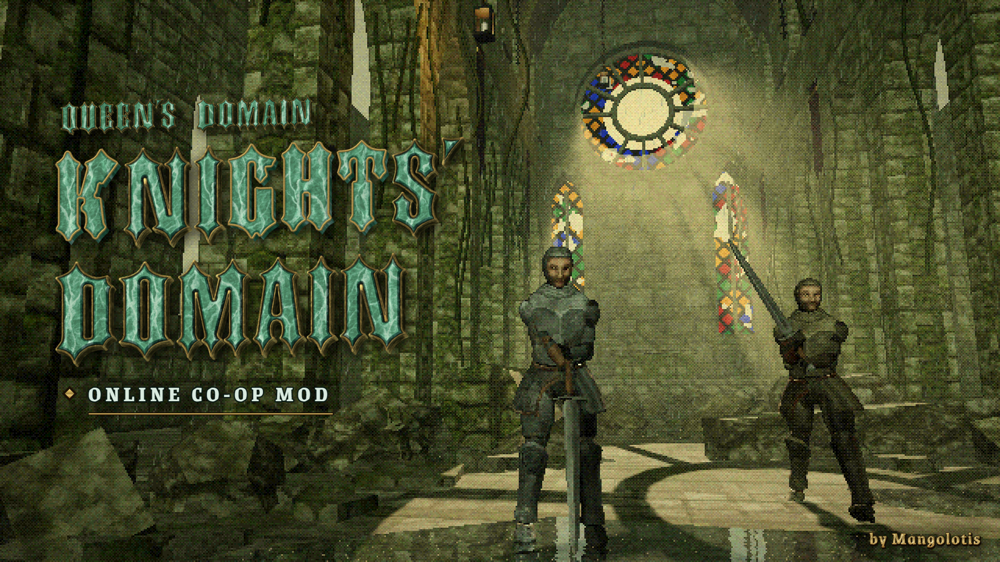

<p align="center">
  
</p>

<h1 align="center">Knights' Domain</h1>
<p align="center"><b>Online co-op mod for <a href="https://store.steampowered.com/app/1799840/Queens_Domain/">Queen's Domain</a></b><br>by Mangolotis</p>

<p align="center">
  <a href="https://github.com/Lotisphere/KnightsDomain/releases/latest"><b>⬇ Download the latest release</b></a>
  &nbsp;·&nbsp;
  <a href="https://store.steampowered.com/app/1799840/Queens_Domain/">Get Queen's Domain on Steam</a>
  &nbsp;·&nbsp;
  <a href="https://www.mangolotis.com/knightsdomain/">Website</a>
</p>

---

Queen's Domain is one of the best exploration games of 2026. Knights' Domain lets you explore it together: host a room, invite your friends through Steam, and fight through the Queen's domain side by side.

## Features

- **Up to 4 players** — a host and up to 3 friends.
- **Steam rooms** — friends join from the Steam friends list (**Join Game**) or from the in-game menu.
- **Shared fights** — enemy positions, attacks and health are kept in sync. Enemies chase and fight whoever they are targeting, archers included.
- **See each other** — friends appear as knights with their name above their head, holding the weapon they actually have equipped and swinging it the way that weapon swings.
- **Light party scaling** — enemies get a little more health per extra player (normal +12%, elite +18%, boss +25%).
- **Your character stays yours** — the world and story progress belong to the host; every player keeps their own character, items and experience.
- **English, 中文 and 日本語** — switch any time in the in-game menu.

## Requirements

- **Queen's Domain on Steam.** Every player needs their own copy, and the game must be started from Steam.
- Windows 10 or 11. No extra runtimes needed.
- Everyone in a room must use the same version of Knights' Domain.

## Installation

1. Download `KnightsDomain-x.y.z.zip` from [Releases](https://github.com/Lotisphere/KnightsDomain/releases/latest).
2. Close the game, then extract the zip into the game folder:
   `...\steamapps\common\QueensDomain\`
   *(Steam → right-click Queen's Domain → Manage → Browse local files)*
3. Check that these files exist:
   ```
   QueensDomain\Binaries\Win64\xinput1_3.dll
   QueensDomain\Binaries\Win64\KnightsDomain\KnightsDomain.dll
   ```
4. Launch Queen's Domain from Steam and press **F5** in game.

## Playing together

| | |
|---|---|
| **Host** | F5 → **Co-op** → **Create room** |
| **Join** | Right-click the host in the Steam friends list → **Join Game**, or F5 → **Co-op** → **Friends' rooms** |
| **Your name** | F5 → **My name** |
| **Back to the host** | F5 → **Teleport** |
| **Language** | F5 → **Co-op** (top) or **About** |

Good to know:
- The game keeps running while the menu is open in co-op.
- Back up your saves before your first session: `%LOCALAPPDATA%\QueensDomain\Saved\SaveGames\`

## Uninstall

Delete `QueensDomain\Binaries\Win64\xinput1_3.dll` and the `QueensDomain\Binaries\Win64\KnightsDomain` folder.

## Help and feedback

Open an [issue](https://github.com/Lotisphere/KnightsDomain/issues) and attach your log:
`%LOCALAPPDATA%\QueensDomain\Saved\KnightsDomain\KnightsDomain.log`

## Permissions

Knights' Domain is free. You're welcome to share links to this page, make videos and stream with it. Please don't re-upload the files elsewhere — link here instead so everyone gets the latest version.

Knights' Domain is a fan-made mod by **Mangolotis** and is not affiliated with the developer of Queen's Domain. If you enjoy it, support the game on [Steam](https://store.steampowered.com/app/1799840/Queens_Domain/).

---

<details>
<summary><b>中文说明</b></summary>

**Knights' Domain** 是《Queen's Domain》的联机 MOD，作者 Mangolotis。最多 4 人一起探索女王的领域。

**需求**：Steam 正版《Queen's Domain》（每位玩家都需要自己的一份，并从 Steam 启动游戏）；Windows 10/11；房间内所有人使用同一版本的 MOD。

**安装**：关闭游戏 → 把压缩包解压到游戏目录 `...\steamapps\common\QueensDomain\`（Steam 右键游戏 → 管理 → 浏览本地文件）→ 从 Steam 启动游戏，游戏内按 **F5**。

**联机**：房主 F5 →「联机」→「创建房间」；好友在 Steam 好友列表里右键房主 →「加入游戏」，或 F5 →「联机」→「好友的房间」。在「联机」页顶部或「关于」页可以切换语言（English / 中文 / 日本語）。

**说明**：世界和剧情进度以房主为准，每位玩家保留自己的角色、物品和经验。首次联机前建议备份存档：`%LOCALAPPDATA%\QueensDomain\Saved\SaveGames\`。

**卸载**：删除 `QueensDomain\Binaries\Win64\xinput1_3.dll` 和 `QueensDomain\Binaries\Win64\KnightsDomain` 文件夹。

</details>

<details>
<summary><b>日本語</b></summary>

**Knights' Domain** は《Queen's Domain》用のオンライン協力プレイ MOD です（作者：Mangolotis）。最大 4 人で女王の領域を一緒に探索できます。

**必要なもの**：Steam 版《Queen's Domain》（プレイヤー全員がそれぞれ所有し、Steam から起動してください）／Windows 10・11／ルーム内の全員が同じバージョンの MOD を使うこと。

**導入**：ゲームを閉じる → zip をゲームフォルダ `...\steamapps\common\QueensDomain\` に展開（Steam でゲームを右クリック → 管理 → ローカルファイルを閲覧）→ Steam からゲームを起動し、ゲーム内で **F5**。

**一緒に遊ぶ**：ホストは F5 →「協力プレイ」→「協力プレイのルームを作成」。参加する人は Steam のフレンドリストでホストを右クリック →「ゲームに参加」、または F5 →「協力プレイ」→「フレンドのルーム」。言語は「協力プレイ」ページ上部か「このMODについて」で切り替えられます。

**補足**：ワールドとストーリーの進行はホストのものが使われ、キャラクター・アイテム・経験値は各自のものが残ります。初めて遊ぶ前にセーブのバックアップをおすすめします：`%LOCALAPPDATA%\QueensDomain\Saved\SaveGames\`

**アンインストール**：`QueensDomain\Binaries\Win64\xinput1_3.dll` と `QueensDomain\Binaries\Win64\KnightsDomain` フォルダを削除してください。

</details>
